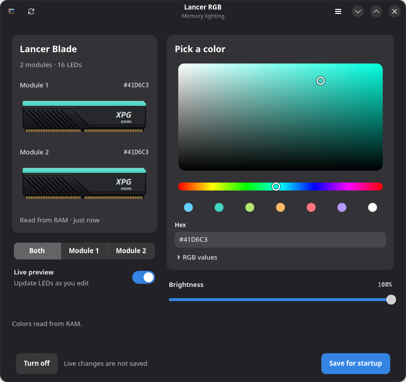

# Lancer RGB

A small GTK 4 / libadwaita app for XPG Lancer Blade RGB memory on Linux.



- In-window saturation/value picker and hue strip; keyboard, hex and RGB input.
- Throttled live preview, per-module selection and eight-LED readback.
- Brightness and off controls.
- Saved colors restored by a systemd boot service.
- Restricted password-free helper access for the installing user's active local session.

## Supported hardware

Verified on **Gigabyte B760 DS3H WIFI6E GEN5** with two **ADATA/XPG
AX5U6000C4816G-BLABR** 16 GiB modules. This is an experimental, hardware-specific
tool, not a general RAM controller. The helper checks the board and Intel I801
adapter and only operates at the observed controller addresses `0x71` and `0x73`.
Module numbers are controller order; their physical A2/B2 mapping is unconfirmed.

Static Linux writes and readback have been verified. Restoration after a full
power-off still needs confirmation; no cold-start discovery or address remapping
is implemented. No bus scans, SPD writes or firmware saves are performed.
SMBus access still carries hardware risk; successful testing on this setup does
not establish safety on other modules or guarantee risk-free operation.

## Run

Fedora dependencies:

```sh
sudo dnf install git python3-gobject python3-cairo gtk4 libadwaita polkit
git clone https://github.com/scanash00/lancer-rgb.git
cd lancer-rgb
python3 lancer_gtk.py --demo  # UI preview; never accesses hardware
sudo python3 install.py
```

Open **Lancer RGB** in the app launcher. Installation requests administrator
access once; subsequent RGB commands do not prompt in that user's active local
session. With root login, pass `--user YOUR_LOCAL_USERNAME` to the installer.

Drag in the color field, move the hue/brightness sliders, select a preset, or
enter a hex value and press Enter. Expand **RGB values** for numeric channels.
Arrow keys operate the color field and hue strip; Shift makes larger steps.
**Live preview** changes the LEDs without saving. **Save for startup** applies and
stores the selection. **Turn off** also saves the off state for startup.

Refresh reads the static buffer from RAM. Effective RGB already includes
brightness: the app keeps a known matching color/brightness pair, otherwise
shows effective RGB at 100%. Animated modes are reported rather than guessed.
Changing the module selection reads that module without applying a new color.

## Installation and persistence

GUI: `/usr/local/share/lancer-rgb`; root-owned helper:
`/usr/local/lib/lancer-rgb` and `/usr/local/bin/lancer-rgb-control`.
Saved per-controller settings: `/var/lib/lancer-rgb/settings.json`.

```sh
systemctl status lancer-rgb.service
journalctl -b -u lancer-rgb.service
sudo systemctl disable lancer-rgb.service  # stop restoring at boot
```

Remove `/etc/polkit-1/rules.d/49-lancer-rgb.rules` to revoke password-free RGB
access. It authorizes only the fixed helper, not arbitrary Python or shell
commands. The GUI stays unprivileged. Do not run competing RGB tools concurrently.
A failed hardware transaction stops the operation and disables live preview.

## Development

Python 3.10+, GTK 4 and libadwaita 1.5+. Protocol code uses the Python standard
library. Tests use captured successful vendor calls and mocked hardware:

```sh
python3 -m unittest discover -v
```

GUI tests run when GTK and a display are available, otherwise skip. Demo mode
uses illustrative data and never calls the privileged helper.

See [DESIGN.md](DESIGN.md) for UI decisions and [PROTOCOL.md](PROTOCOL.md) for
protocol evidence and remaining uncertainties. Raw proprietary binaries and
full investigation traces are not part of this source package.

## License

GPL-2.0-or-later. See [LICENSE](LICENSE) and [NOTICE.md](NOTICE.md).
